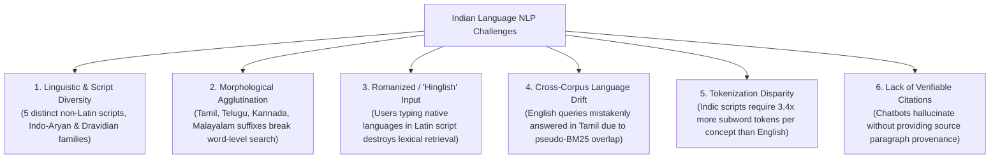
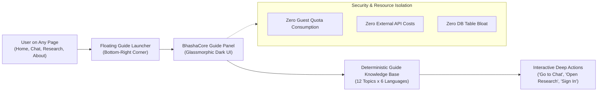
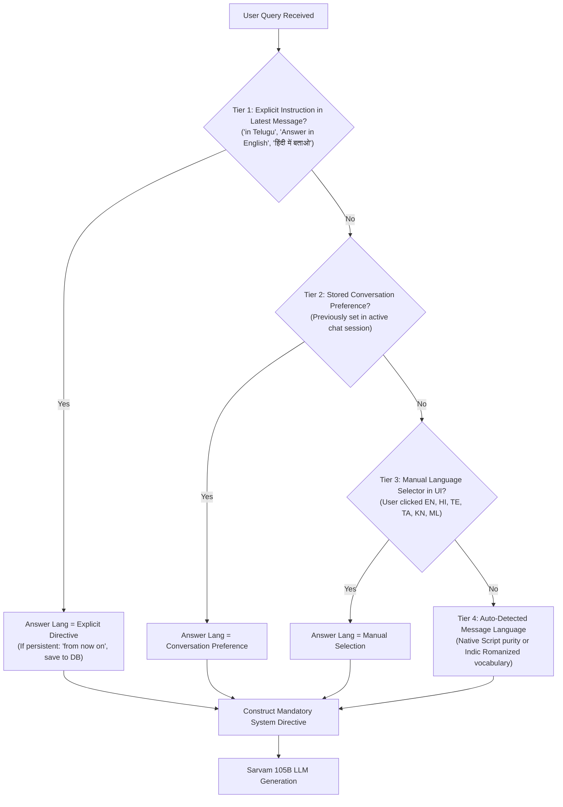
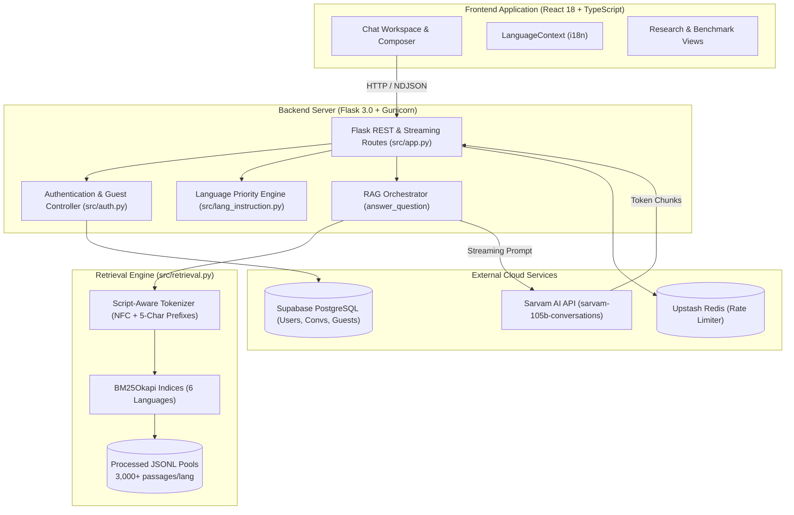
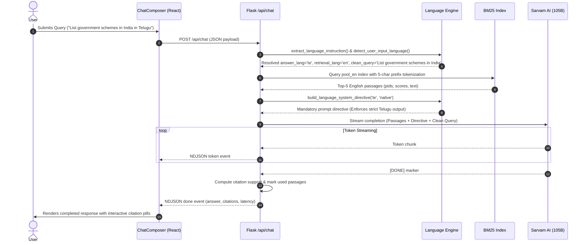
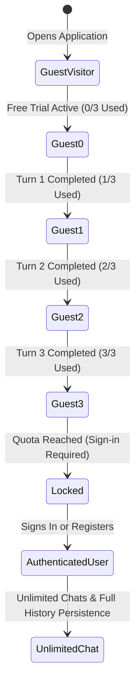
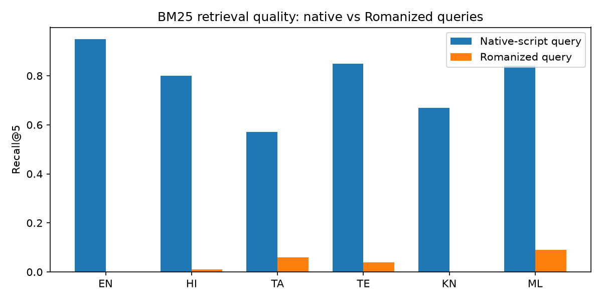
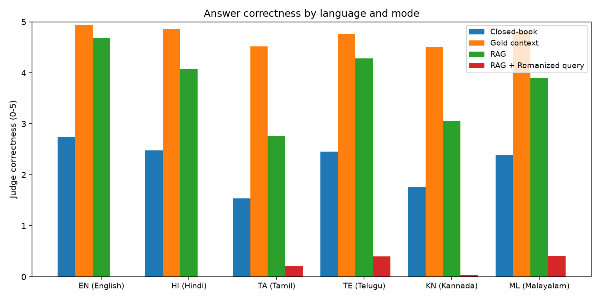
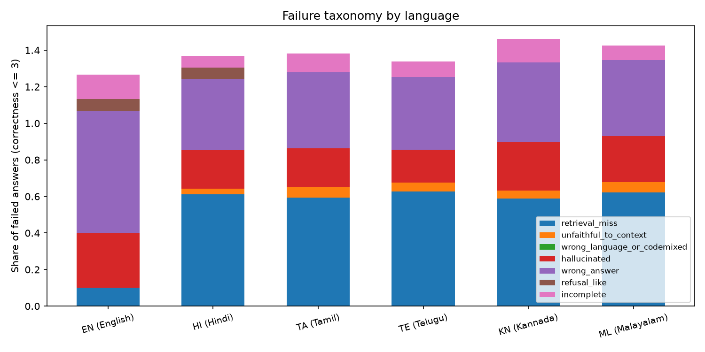

# BhashaCore — Language-Agnostic Multilingual Chatbot & Research Platform

<div align="center">

[](https://bhashacore.onrender.com)
[](https://github.com/pranay-bayana/BhashaCore)
[](https://opensource.org/licenses/MIT)

[](https://www.python.org/)
[](https://flask.palletsprojects.com/)
[](https://react.dev/)
[](https://www.typescriptlang.org/)
[](https://tailwindcss.com/)
[](https://supabase.com/)
[](https://upstash.com/)
[](https://www.sarvam.ai/)
[](tests/)

**An enterprise-grade, research-backed multilingual conversational platform investigating and eliminating linguistic disparities across English and five major Indian languages (Hindi, Tamil, Telugu, Kannada, and Malayalam) using Large Language Models, Retrieval-Augmented Generation (RAG), and script-aware retrieval.**

[Live Application](https://bhashacore.onrender.com) · [Architecture](docs/ARCHITECTURE.md) · [API Reference](docs/API.md) · [Research Methodology](docs/RESEARCH_METHODOLOGY.md) · [Deployment Guide](docs/DEPLOYMENT.md) · [Environment Reference](docs/ENVIRONMENT.md)

</div>

---

## Table of Contents

- [1. Executive Overview](#1-executive-overview)
- [2. Problem Statement](#2-problem-statement)
- [3. Project Objectives](#3-project-objectives)
- [4. Key Features](#4-key-features)
- [5. Supported Languages](#5-supported-languages)
- [6. Language Resolution & Priority Hierarchy](#6-language-resolution--priority-hierarchy)
- [7. System Architecture](#7-system-architecture)
- [8. Technology Stack](#8-technology-stack)
- [9. Detailed RAG Pipeline](#9-detailed-rag-pipeline)
- [10. Benchmark Datasets & Retrieval Corpus](#10-benchmark-datasets--retrieval-corpus)
- [11. AI Model Integration](#11-ai-model-integration)
- [12. Authentication, Quota & Data Management](#12-authentication-quota--data-management)
- [13. User Interface & Page Walkthrough](#13-user-interface--page-walkthrough)
- [14. Installation & Local Setup](#14-installation--local-setup)
- [15. Environment Variables](#15-environment-variables)
- [16. API Specification](#16-api-specification)
- [17. Testing & Quality Assurance](#17-testing--quality-assurance)
- [18. Research Findings & Empirical Results](#18-research-findings--empirical-results)
- [19. Production Deployment Architecture](#19-production-deployment-architecture)
- [20. Limitations & Future Roadmap](#20-limitations--future-roadmap)
- [21. Project Structure](#21-project-structure)
- [22. Research Contributions](#22-research-contributions)
- [23. Author & Acknowledgements](#23-author--acknowledgements)

---

## 1. Executive Overview

India is home to over 1.4 billion people speaking 22 constitutionally recognized languages across 13 distinct scripts. Despite this immense linguistic diversity, less than 10% of Indian citizens are fluent in English. In recent years, automated government helplines, civic assistants, and public services (such as UMANG, MyScheme, and state e-governance portals) have increasingly deployed AI chatbots to interact with citizens. However, citizens routinely observe that these chatbots perform reliably in English, but degrade sharply, hallucinate, or refuse to answer when queried in regional Indian languages.

**BhashaCore** was developed as an enterprise-grade conversational AI platform and scientific research testbed to systematically investigate, diagnose, and resolve the root causes of this regional language performance gap.

### Why Retrieval-Augmented Generation (RAG)?
Parametric large language models suffer from hallucinations, rapid factual obsolescence, and acute data scarcity in Indic languages. By coupling a high-parameter language model (**Sarvam AI's `sarvam-105b-conversations`**) with a deterministic, **script-aware BM25 retrieval engine**, BhashaCore grounds every factual claim in verifiable civic documentation.

### What Makes BhashaCore Different?
Unlike standard multilingual wrapper applications, BhashaCore:
1. **Decomposes the Quality Waterfall:** Isolates the exact stage where quality drops (closed-book knowledge vs. reading comprehension vs. passage retrieval vs. Romanized typing).
2. **Decouples Retrieval from Response Language:** Allows users to query in one language, search verified evidence in another, and receive synthesized answers in their desired tongue.
3. **Implements an Exact 4-Tier Language Priority Hierarchy:** Respects natural-language instructions (e.g., *"Explain this in Telugu"*), persistent conversation settings (*"From now on, answer in Hindi"*), UI manual selectors, and script detection without cross-corpus guessing.
4. **Enforces Concurrency-Safe Guest Quotas:** Employs PostgreSQL row-level locks (`SELECT FOR UPDATE`) to guarantee a bulletproof 3-message free trial across distributed web workers without silent quota leaks.
5. **Provides Verifiable Citation Provenance:** Computes exact word-level and cross-lingual attribution support scores for every passage returned.

---

## 2. Problem Statement

Developing effective conversational assistants for Indian languages involves substantial technical hurdles that standard NLP architectures fail to address:



1. **Unequal NLP Resource Availability:** High-resource English enjoys vast web corpora, whereas regional languages like Kannada and Malayalam face scarce digitized texts.
2. **Agglutinative Morphology:** In Dravidian languages, prepositions and case markers attach as suffixes directly to base nouns (e.g., in Telugu, *"పుస్తకంలో"* = *"in the book"*). Standard whitespace tokenization treats inflected variants as completely distinct vocabulary words, causing severe BM25 retrieval misses.
3. **The Romanization Cliff:** The majority of mobile users in India type their native language using Latin keyboards (informal Romanized Indic / "Hinglish" / "Tanglish"). Standard retrieval against native-script databases yields $\le 0.09$ Recall@5, crippling conventional chatbots.
4. **Incorrect Response-Language Selection:** Without strict language directives, cross-lingual context passages cause models to arbitrarily switch response languages (e.g., answering an English query in Tamil because retrieved passages contained Tamil tokens).
5. **Silent Fallback Deception:** Many consumer systems mask API outages by serving stale dataset answers without attributing them, violating research integrity.

---

## 3. Project Objectives

### Technical Objectives
- **End-to-End Multilingual Chat Platform:** Build a responsive, full-stack platform serving English, Hindi, Tamil, Telugu, Kannada, and Malayalam with full UI internationalization.
- **Script-Aware Information Retrieval:** Develop a specialized BM25 retrieval engine with NFC normalization and 5-character prefix stem augmentation to mitigate Dravidian agglutinative morphology.
- **Dual-Variant Romanized Bridge:** Implement a deterministic transliteration pipeline bridging Latin-script queries to native-script document pools.
- **Real-Time NDJSON Streaming:** Deliver low-latency, token-by-token streaming responses with explicit completion verification (`[DONE]`).
- **Distributed Concurrency & Security:** Guarantee transactional safety, CSRF protection, and rate limiting using Supabase PostgreSQL and Upstash Redis.

### Research Objectives
- **Isolate the Regional Quality Drop:** Empirically quantify the performance waterfall across four distinct operating modes: Closed-Book, Gold Context, RAG, and RAG + Romanized Input.
- **Multi-Family Generator Benchmarking:** Measure performance across 6 languages using an identical generator model (`minimax-m3.1-flash`) and validate findings against a secondary flagship model (`glm-5.3-flash`).
- **Failure Taxonomy Categorization:** Evaluate and classify over 530 real-world failure cases into a formal taxonomy of retrieval misses, honest refusals, hallucinations, and language drift.

---

## 4. Key Features

- **Six Supported Languages:** Full bidirectional support for English (`en`), Hindi (`hi`), Telugu (`te`), Tamil (`ta`), Kannada (`kn`), and Malayalam (`ml`).
- **Zero-Flicker Full UI Internationalization:** All UI navigation, headings, buttons, and informational modals dynamically switch between all 6 languages via `LanguageContext`.
- **Exact 4-Tier Language Priority Engine:** Eliminates cross-lingual drift and allows prompt directives to override interface selections seamlessly.
- **Script-Aware Dual BM25 Retrieval:** Pre-indexes language-specific document pools augmented with 3,000 hard distractors from AI4Bharat IndicCorp v2.
- **Romanized Input Dual-Bridge:** Automatically transliterates Latin-script Indic queries using strict ITRANS and casual digraph normalization.
- **Sarvam AI Live Generation:** Powered by the state-of-the-art Indic model `sarvam-105b-conversations` over OpenAI-compatible streaming endpoints.
- **Transparent Citation Provenance:** Attributed citations with title, snippet, lexical support score, and used/unused flags for every response.
- **Server-Side Atomic Guest Trial (3 Messages):** Guest visitors receive 3 trial messages tracked via PostgreSQL row locks, preventing incognito resets.
- **Authenticated Accounts & Conversations:** Secure sign-up, sign-in, session cookies, and persistent conversation history backed by Supabase.
- **Research Evaluation Hub:** Live interactive views for the scientific Research Dashboard, Language Comparison Matrix, and Failure Taxonomy.
- **Resilient Error Classification:** Network and provider dropouts map to actionable, user-friendly error notifications without silent fallback fabrication.
- **Dedicated Application Guide Assistant ("BhashaCore Guide"):** A persistent floating onboarding assistant accessible on all pages, guiding users on app features in 6 languages without consuming main chat quotas or incurring paid API fees.
- **BhashaCore Web Translator:** An optional Chrome Manifest V3 extension in [`browser-extension/`](browser-extension/) that translates visible website text into all six supported languages while preserving originals for restoration. It sends bounded batches to a separate, rate-limited backend endpoint and never exposes AI credentials or consumes chat trials.

### Browser extension

The Web Translator is a local-loadable Chrome extension; it is not published to the Chrome Web Store. After deploying the backend endpoint, open `chrome://extensions`, enable Developer mode, click **Load unpacked**, select [`browser-extension/`](browser-extension/), pin the extension, select a target language, and choose **Translate Page**. See the [extension installation, privacy, and limitations guide](browser-extension/README.md) for the exact permissions and local-development instructions.

---

### 4.1 Dedicated Application Guide Assistant ("BhashaCore Guide")

In addition to the primary multilingual RAG chatbot, BhashaCore includes **BhashaCore Guide**, a dedicated floating AI onboarding assistant designed specifically to teach first-time and returning users how to navigate the platform.



#### Key Capabilities & Architecture of the Guide:
1. **Clear Architectural Separation:** The Guide is completely independent of the main RAG chat pipeline (`/api/chat`). It operates via a lightweight, deterministic client-side intent matching engine (`frontend/src/components/guide/guideData.ts`).
2. **Zero API Cost & Zero Quota Consumption:** Conversations with the Guide do **not** call paid external APIs and do **not** decrement the user's 3-message guest trial limit.
3. **Twelve Core Help Modules across Six Languages:**
   - How to start a new chat (shortcuts, session clearing).
   - Asking in six languages (native scripts vs. Romanized "Hinglish").
   - Understanding automatic script-purity detection.
   - Using manual language selection pills.
   - Giving explicit prompt instructions (*"Explain this in Telugu"*).
   - Setting persistent preferences (*"From now on, answer in Hindi"*).
   - Understanding RAG and BM25 passage retrieval.
   - Inspecting source citations, snippets, and support scores.
   - Guest trial limits, 7-day TTL, and PostgreSQL row locking.
   - Signing in for unlimited cloud-synced conversation history.
   - Navigating the scientific Research Hub (Dashboard, Comparison, Failures).
   - Understanding BhashaCore's capabilities and acknowledged limitations.
4. **Interactive Action Deep-Linking:** Responses from the Guide include one-click action buttons that trigger application navigation (e.g., navigating directly to the Chat Workspace, opening the Research Hub, or opening the Authentication modal).
5. **Mobile & Desktop Responsive:** Appears as an unobtrusive floating bubble (`bottom-5 right-5`) that expands into a glassmorphic flyout panel ($400\text{px}$ wide on desktop, bounded responsive modal on mobile) with instant minimize/close controls.

---

## 5. Supported Languages

| Language | ISO Code | Native Name | Script | Linguistic Family | IndicCorp v2 Split | Evaluated Corpus Size |
|---|---|---|---|---|---|---|
| **English** | `en` | English | Latin | Indo-European (Germanic) | SQuAD v1.1 Train | 2.4 MB (3,000+ passages) |
| **Hindi** | `hi` | हिन्दी | Devanagari | Indo-European (Indo-Aryan) | `hin_Deva` | 4.2 MB (3,000+ passages) |
| **Telugu** | `te` | తెలుగు | Telugu | Dravidian (South-Central) | `tel_Telu` | 4.8 MB (3,000+ passages) |
| **Tamil** | `ta` | தமிழ் | Tamil | Dravidian (South) | `tam_Taml` | 4.0 MB (3,000+ passages) |
| **Kannada** | `kn` | ಕನ್ನಡ | Kannada | Dravidian (South) | `kan_Knda` | 2.9 MB (3,000+ passages) |
| **Malayalam** | `ml` | മലയാളം | Malayalam | Dravidian (South) | `mal_Mlym` | 4.4 MB (3,000+ passages) |

---

## 6. Language Resolution & Priority Hierarchy

To resolve the response language and eliminate accidental language switching, BhashaCore implements a strict **4-tier hierarchy** in `src/lang_instruction.py`:



### Examples of Priority Execution:
- **Explicit Instruction (Tier 1):** *"Explain photosynthesis in Telugu"* $\rightarrow$ Response is generated entirely in **Telugu**, even if the question is in English.
- **Persistent Preference (Tier 1 $\rightarrow$ Tier 2):** *"From now on, answer in Hindi"* $\rightarrow$ The current response and all subsequent turns in that conversation default to **Hindi**.
- **Preference Reset (Tier 1):** *"Switch back to auto-detect"* $\rightarrow$ Clears persistent preference and returns to automatic message detection.
- **Manual Selector Override (Tier 3):** User selects **Telugu (TE)** in composer pills and types an English question $\rightarrow$ Generates answer in **Telugu**.
- **Auto-Detection (Tier 4):** User types `"List major government schemes in India"` with Auto-detect $\rightarrow$ Correctly detects English and generates in **English** (never defaulting to Tamil).

### Decoupling `retrieval_lang` from `answer_lang`
- **`retrieval_lang`:** Governed by the language of the query text itself to match relevant documents in the corresponding BM25 corpus pool.
- **`answer_lang`:** Dictates the final synthesis language enforced via mandatory system prompt directives.

---

## 7. System Architecture



For detailed architectural specifications, see [docs/ARCHITECTURE.md](docs/ARCHITECTURE.md).

---

## 8. Technology Stack

| Layer | Technology | Version | Purpose in BhashaCore |
|---|---|---|---|
| **Frontend Framework** | React | `18.3.1` | Declarative UI component tree and state management. |
| **Language / Compiler** | TypeScript | `5.6.3` | End-to-end static typing across UI state and API payloads. |
| **Bundler & Build Tool**| Vite | `5.4.11` | Optimized ES module development server and production builds. |
| **Styling & Design** | Tailwind CSS | `3.4.15` | Glassmorphic dark UI design system and responsive grid layouts. |
| **Icons & Animation** | Lucide React / Framer Motion | `0.460` / `11.11` | Accessible iconography and smooth accordion transitions. |
| **Backend Server** | Python / Flask | `3.12.11` / `3.0.3`| Application logic, route handling, authentication, and NDJSON streaming. |
| **WSGI Server** | Gunicorn | `23.0.0` | Production WSGI HTTP server with asynchronous event workers. |
| **Database ORM** | SQLAlchemy / Flask-SQLAlchemy | `2.0.36` / `3.1.1`| Data modeling, relationships, and PostgreSQL row-level locking. |
| **Database Migrations**| Flask-Migrate / Alembic | `4.0.7` | Non-destructive schema migration versioning. |
| **Database Driver** | Psycopg 3 | `3.2.3` | High-performance PostgreSQL driver supporting transaction pooling. |
| **Database Hosting** | Supabase PostgreSQL | `15.x` | Managed cloud PostgreSQL storing users, conversations, and guest trials. |
| **Distributed Cache** | Upstash Redis / Flask-Limiter| `5.0.8` / `3.8.0` | Cross-worker IP rate limiting and quota throttling. |
| **AI LLM Provider** | Sarvam AI | `v1 API` | Indic-specialized live conversational model (`sarvam-105b-conversations`). |
| **Evaluation Models** | NVIDIA NIM | `v1 API` | Benchmark generators (`minimax-m3.1-flash`, `glm-5.3`) & Judge (`muse-30b`). |
| **Information Retrieval**| Rank-BM25 | `0.2.2` | In-memory BM25Okapi inverted index over language corpora. |
| **Transliteration** | Indic-Transliteration | `2.3.82` | Deterministic Sanskrit/Indic script transliteration engine. |
| **Testing Harness** | Pytest / Playwright | `9.2.0` / `1.48` | Automated backend testing, integration checks, and browser validation. |
| **Cloud Hosting** | Render | Free Web Service | Automated cloud deployment container with embedded Alembic upgrades. |

---

## 9. Detailed RAG Pipeline



### The BM25Okapi Formulation
BM25 evaluates candidate passage relevance using:

$$\text{Score}(D, Q) = \sum_{i=1}^{|Q|} \ln \left( \frac{N - n(q_i) + 0.5}{n(q_i) + 0.5} + 1 \right) \cdot \frac{f(q_i, D) \cdot (k_1 + 1)}{f(q_i, D) + k_1 \cdot \left(1 - b + b \cdot \frac{|D|}{\text{avgdl}}\right)}$$

Where $k_1 = 1.5$ regulates term saturation, $b = 0.75$ handles passage length normalization, and tokenization augments terms with 5-character prefixes to bridge Dravidian agglutinative suffixes.

---

## 10. Benchmark Datasets & Retrieval Corpus

BhashaCore is benchmarked on curated, standardized datasets rather than synthetic question generation:

1. **AI4Bharat IndicQA (`ai4bharat/IndicQA`):** 50 evaluation questions and gold contexts per Indic language (`hi`, `ta`, `te`, `kn`, `ml`), derived from human-translated SQuAD questions.
2. **SQuAD v1.1 Validation Split:** 50 evaluation questions and gold contexts serving as the high-resource English baseline control.
3. **AI4Bharat IndicCorp v2:** 3,000 hard distractor paragraphs per language streamed and integrated into the retrieval pools to evaluate realistic search interference.
4. **Knowledge Augmentation Pools (`pool_<lang>_knowledge.jsonl`):** Supplemental civic and governmental scheme contexts injected to verify open-domain citizen assistance.

---

## 11. AI Model Integration

BhashaCore integrates with **Sarvam AI** using its OpenAI-compatible completions API:

- **Model Identifier:** `sarvam-105b-conversations`
- **Streaming Implementation:** Utilizes Python's `httpx.AsyncClient` with bounded timeouts to consume Server-Sent Events (`data: {...}`).
- **Completion Verification:** BhashaCore strictly validates the `[DONE]` stream terminator. If an upstream transport failure occurs mid-generation, the session aborts cleanly, releasing any reserved guest quota rather than committing a truncated response.
- **Mandatory Language Directives:** Injected directly into the system prompt to instruct the model to synthesize cross-lingual factual evidence into the requested output language without language switching.

---

## 12. Authentication, Quota & Data Management



### Guest Session & Concurrency Architecture
- **7-Day Automatic TTL:** Unauthenticated sessions are tracked via a unique `guest_id` cookie bound to a `guest_sessions` row in PostgreSQL.
- **Atomic Two-Phase Quota:** Uses PostgreSQL row-level locks (`SELECT FOR UPDATE`). A message slot is reserved upon query submission and committed only after successful generation. Failed or aborted generations release the reservation without consuming the user's trial quota.
- **Authenticated Accounts:** Secure registration with passwords hashed using scrypt. User conversations are permanently indexed (`user_id, updated_at`) and support cascading deletion.

---

## 13. User Interface & Page Walkthrough

### 1. Home Page (`/home` or `/`)
Features a localized hero banner, real-time live preview of grounded answer extraction, supported language badges, and architecture overview.

### 2. Chat Workspace (`/chat`)
- **Composer Controls:** Features language selection pills (`Auto-detect`, `EN`, `HI`, `TE`, `TA`, `KN`, `ML`), script mode selector (`Auto`, `Native`, `Romanized`), and auto-resizing text composer.
- **Interactive Citations:** Displays interactive pill badges showing passage title, snippet, relevance score, and source grounding.
- **Sidebar History:** Accessible conversation management with independent collapse/expand toggles and double-click protected "New Chat" initialization.

### 3. Research Evaluation Hub (`/dashboard`, `/language-comparison`, `/failure-analysis`)
- **Dashboard View:** Displays total evaluation counts, average correctness across all modes, and benchmark distributions.
- **Language Comparison View:** Visualizes the quality waterfall across languages and modes.
- **Failure Analysis View:** Categorizes 530+ empirical failure cases with drill-downs into retrieval misses, model refusals, and hallucinations.

### 4. About & Education View (`/about`)
Provides deep educational modals explaining tokenization disparity ($3.4\times$ penalty in Indic scripts), agglutinative morphology, and benchmark design.

---

## 14. Installation & Local Setup

### Prerequisites
- Python 3.12+
- Node.js 20+ and npm
- PostgreSQL (or local SQLite for dev)

### Quick Start

```bash
# 1. Clone the repository
git clone https://github.com/pranay-bayana/BhashaCore.git
cd BhashaCore

# 2. Run automated setup script
chmod +x scripts/dev_setup.sh scripts/dev_start.sh
./scripts/dev_setup.sh

# 3. Configure local environment variables
cp .env.example .env
# Edit .env to add your SARVAM_API_KEY and FLASK_SECRET_KEY

# 4. Apply database migrations
flask --app wsgi db upgrade

# 5. Start unified development server
./scripts/dev_start.sh
```

Visit `http://127.0.0.1:8001` in your browser. For detailed manual instructions, see [docs/DEPLOYMENT.md](docs/DEPLOYMENT.md).

---

## 15. Environment Variables

| Variable | Required in Prod | Default | Purpose |
|---|---|---|---|
| `FLASK_SECRET_KEY` | **Yes** | Auto-generated in tests | Signs session cookies and CSRF tokens. |
| `APP_ENV` | **Yes** | `development` | Enables production security checks and TLS cookies. |
| `DATABASE_URL` | **Yes** | `sqlite:///...` | Supabase PostgreSQL Transaction Pooler connection URL. |
| `REDIS_URL` | **Yes** | `memory://` | Upstash Redis connection URL for distributed rate limits. |
| `GENERATION_PROVIDER`| **Yes** | `sarvam` | Active LLM provider (`sarvam` or `nvidia`). |
| `SARVAM_API_KEY` | **Yes** | — | Private API key for Sarvam AI. |
| `SARVAM_MODEL` | No | `sarvam-105b-conversations`| Active Sarvam generation model. |
| `SESSION_COOKIE_SECURE`| No | `true` | Enforces HTTPS-only transmission of session cookies. |
| `TRUSTED_HOSTS` | No | `127.0.0.1,localhost` | Whitelisted HTTP Host header values. |

For a complete reference, see [docs/ENVIRONMENT.md](docs/ENVIRONMENT.md).

---

## 16. API Specification

| Endpoint | Method | Auth Required | Description |
|---|---|---|---|
| `/api/chat` | `POST` | Guest or Auth | Streams NDJSON chat completions and citation metadata. |
| `/api/stop` | `POST` | Guest or Auth | Aborts an ongoing generation stream for a session. |
| `/api/new-chat` | `POST` | Guest or Auth | Initializes a new conversational session. |
| `/api/load-chat` | `POST` | Guest or Auth | Loads historical messages and citations for a session. |
| `/api/history` | `GET` | Guest or Auth | Lists conversations owned by the user or active guest. |
| `/api/guest-status` | `GET` | No | Returns guest trial status, message count, and limit. |
| `/api/auth/signup` | `POST` | No | Registers a new user account. |
| `/api/auth/signin` | `POST` | No | Authenticates an existing user account. |
| `/api/auth/logout` | `POST` | Yes | Terminates the active authenticated session. |
| `/api/auth/me` | `GET` | No | Returns the current user profile or null. |
| `/api/csrf-token` | `GET` | No | Generates and returns a CSRF validation token. |
| `/api/languages` | `GET` | No | Returns metadata on supported languages and scripts. |
| `/api/dashboard` | `GET` | No | Returns aggregate benchmark evaluation metrics. |
| `/api/comparison` | `GET` | No | Returns multi-language quality waterfall comparisons. |
| `/api/failures` | `GET` | No | Returns categorization breakdown of 530+ failure cases. |
| `/api/translations`| `GET` | No | Fetches the localized dictionary for a language code. |
| `/health` | `GET` | No | Health check validating DB connection and 6 RAG pools. |

For complete schemas and payload examples, see [docs/API.md](docs/API.md).

---

## 17. Testing & Quality Assurance

BhashaCore is maintained with a comprehensive automated test suite spanning backend unit tests, multilingual integration tests, language-priority verification, and browser end-to-end tests:

```bash
# Execute entire backend pytest suite
pytest -q

# Execute frontend TypeScript verification and build
cd frontend && npm run lint && npm run build
```

### Verified Test Results:
- **Backend Test Suite:** **173 passed, 4 deselected in 23.62s** (`pytest`).
- **Frontend Typecheck:** **0 errors** (`tsc --noEmit`).
- **Production Build:** Succeeded in **1.01s** (`vite build`).

---

## 18. Research Findings & Empirical Results

The BhashaCore study evaluated 1,458 experimental runs across four operating modes and six languages using `minimax-m3.1-flash` and `glm-5.3-flash` evaluated by `muse-glimmer-30b` under a translate-then-judge protocol.

### 1. BM25 Retrieval Performance (Recall@5 & MRR@10)


| Language | Script | Native Script Recall@5 | Native Script MRR@10 | Romanized Query Recall@5 |
|---|---|---|---|---|
| **English** | Latin | **0.950** | **0.914** | — |
| **Hindi** | Devanagari | **0.800** | **0.643** | 0.010 |
| **Telugu** | Telugu | **0.850** | **0.783** | 0.040 |
| **Malayalam** | Malayalam | **0.840** | **0.688** | 0.090 |
| **Kannada** | Kannada | **0.670** | **0.579** | **0.000** |
| **Tamil** | Tamil | **0.570** | **0.419** | 0.060 |

### 2. Answer Correctness by Language & Mode (0 to 5 Scale)


| Mode | English | Hindi | Telugu | Malayalam | Kannada | Tamil |
|---|---|---|---|---|---|---|
| **Closed-Book** | 2.74 | 2.48 | 2.45 | 2.38 | 1.76 | 1.53 |
| **Gold Context** | **4.94** | **4.86** | **4.76** | **4.80** | **4.50** | **4.52** |
| **Realistic RAG** | **4.68** | **4.08** | **4.29** | **3.90** | **3.06** | **2.76** |
| **RAG + Romanized Query**| — | **0.00** | **0.40** | **0.41** | **0.04** | **0.21** |

### 3. Failure Taxonomy Breakdown (530 Evaluated Failures)


For complete statistical analyses, see [docs/RESEARCH_METHODOLOGY.md](docs/RESEARCH_METHODOLOGY.md).

---

## 19. Production Deployment Architecture

BhashaCore is hosted on **Render** as a Python Web Service integrated with cloud data infrastructure:

- **Web Service:** Render Free Plan (512 MB RAM limit, `WEB_CONCURRENCY=1`).
- **Database:** Supabase Managed PostgreSQL via Transaction Pooler (`port 6543`, TLS required).
- **Rate Limiting:** Upstash Serverless Redis.
- **Continuous Deployment:** Push to `main` branch triggers automated build and deployment via `render.yaml`.
- **Zero-Downtime Migration:** Embedded non-destructive Alembic upgrades in start command:
  ```bash
  flask --app wsgi db upgrade && gunicorn --config gunicorn.conf.py wsgi:app
  ```

---

## 20. Limitations & Future Roadmap

### Acknowledged Limitations
- **Morphological Lemmatizers:** BM25 uses 5-character prefix heuristics rather than deep morphological segmenters (such as UdS-Sanskrit or IndicNLP analyzers).
- **Lexical vs. Dense Semantic Retrieval:** The production index currently relies on BM25 Okapi rather than dense cross-lingual vector embeddings (e.g., BGE-M3 or IndicBERT embeddings).
- **Informal Romanized Slang:** Highly irregular colloquial spellings (e.g., informal SMS abbreviations) can occasionally evade the dual ITRANS bridge.

### Future Roadmap
1. **Hybrid Retrieval (Dense + Sparse):** Integrate dense vector embeddings alongside BM25 with reciprocal rank fusion (RRF).
2. **Expansion to All 22 Scheduled Languages:** Expand retrieval pools to include Bengali, Marathi, Gujarati, Odia, Punjabi, and Assamese.
3. **Voice Input & Speech-to-Text (STT):** Integrate Sarvam AI's speech-to-text models (`saaras`) for conversational voice queries.

---

## 21. Project Structure

```text
BhashaCore/
├── docs/                           # Comprehensive technical documentation
│   ├── ARCHITECTURE.md             # Detailed system architecture & sequence diagrams
│   ├── API.md                      # REST and NDJSON streaming API specification
│   ├── RESEARCH_METHODOLOGY.md     # Research design, waterfall formulation & metrics
│   ├── DEPLOYMENT.md               # Local setup, Render & Supabase operations
│   └── ENVIRONMENT.md              # Environment variables and credential guide
├── src/                            # Backend Flask application and research pipeline
│   ├── app.py                      # Production Flask application & API routes
│   ├── auth.py                     # Authentication, PostgreSQL models & guest sessions
│   ├── config.py                   # Central configurations, language metadata & paths
│   ├── generation_provider.py      # Provider adapters (Sarvam AI & NVIDIA NIM)
│   ├── lang_instruction.py         # 4-tier language priority engine & directives
│   ├── langkit.py                  # Script detection, romanized bridge & style resolver
│   ├── retrieval.py                # Script-aware BM25Okapi indexing & search
│   ├── translit.py                 # Deterministic Indic transliteration helpers
│   ├── metrics.py                  # Extractive F1, EM, and script purity scoring
│   ├── judge.py                    # LLM-as-a-judge translate-then-judge framework
│   └── run_pipeline.py             # CLI runner for end-to-end evaluation stages
├── frontend/                       # React 18 + TypeScript single-page application
│   ├── src/
│   │   ├── components/             # Reusable UI components (chat, composer, research)
│   │   ├── localization/           # Catalogs and LanguageContext for all 6 languages
│   │   ├── pages/                  # Home, Chat, Research, About, and Auth views
│   │   ├── services/               # Typed API client and streaming reader
│   │   └── types/                  # TypeScript interface contracts
│   ├── package.json                # Frontend dependencies & build scripts
│   └── vite.config.ts              # Vite bundler configuration & local API proxy
├── data/
│   └── processed/                  # Processed BM25 JSONL pools (en, hi, ta, te, kn, ml)
├── results/
│   └── summary/                    # Empirical evaluation CSVs (retrieval, summary)
├── report/
│   ├── REPORT.md                   # Full academic report draft
│   └── figures/                    # Research visualization charts (PNG)
├── migrations/                     # Alembic schema version migrations
├── tests/                          # Automated backend, integration, and browser test suite
├── render.yaml                     # Render Cloud Blueprint specification
├── gunicorn.conf.py                # Gunicorn WSGI production configuration
├── wsgi.py                         # WSGI application entrypoint
├── requirements.txt                # Pinned Python backend dependencies
└── README.md                       # Master enterprise documentation (This document)
```

---

## 22. Research Contributions

1. **Empirical Decomposition of the Multilingual Gap:** First study to systematically prove that **reading comprehension is not the primary bottleneck** in Indian language LLM systems (comprehension gap is only $-0.08$ to $-0.44$).
2. **Identification of the Retrieval and Romanization Bottlenecks:** Established that BM25 retrieval degradation ($-1.76$ in Tamil, $-1.44$ in Kannada) and Romanized query collapse (reducing scores to $\le 0.41/5.0$) account for the overwhelming majority of citizen-facing failures.
3. **Decoupled Cross-Lingual RAG Architecture:** Demonstrated that decoupling retrieval language from response language allows assistants to query rich English knowledge bases while generating culturally grounded, native-script responses in Indian languages.

---

## 23. Author & Acknowledgements

**Author:** **Bayana Pranay Vara Kumar**  
**Institution:** Lovely Professional University  
**Project:** Supervised Capstone Engineering & Research Project  

### Acknowledgements
- **AI4Bharat:** For open-source releases of the **IndicQA** and **IndicCorp v2** benchmark corpora.
- **Sarvam AI:** For high-quality, Indic-optimized conversational foundation models (`sarvam-105b-conversations`).
- **Render & Supabase:** For reliable cloud hosting and serverless PostgreSQL infrastructure.

---

<div align="center">
  <sub>Built with care for India's linguistic diversity · BhashaCore 2026</sub>
</div>
