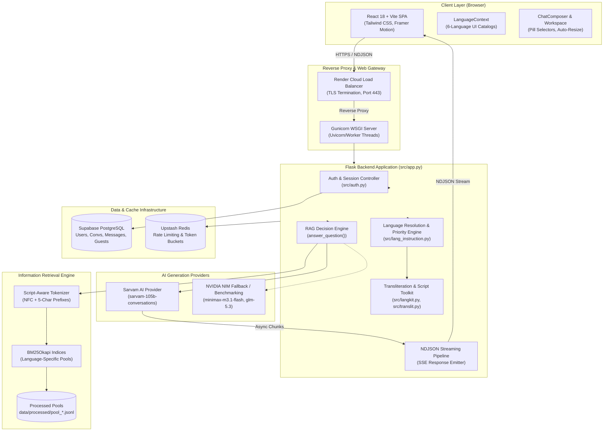
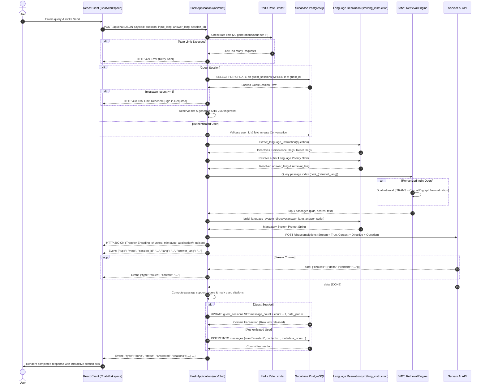
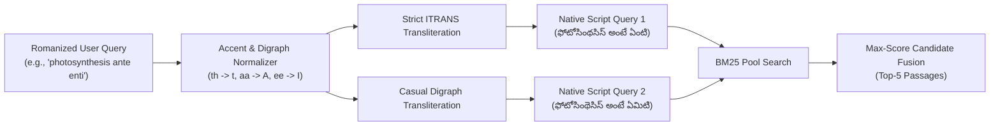
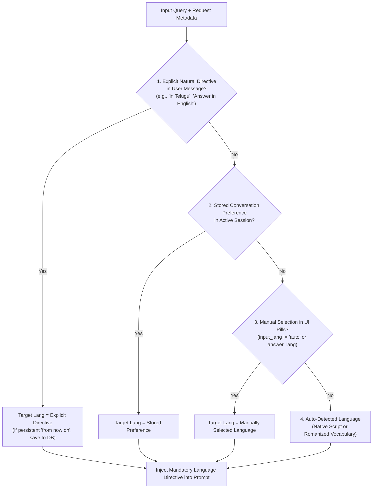
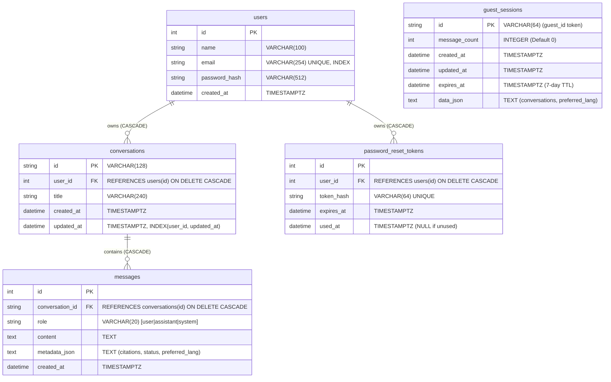

# BhashaCore System Architecture

This document provides a comprehensive technical overview of the system architecture, component boundaries, data flows, and security model of **BhashaCore**, an enterprise-grade multilingual conversational AI platform and research workbench supporting English and five major Indian languages (Hindi, Tamil, Telugu, Kannada, and Malayalam).

---

## 1. Architectural Overview & Design Philosophy

BhashaCore is designed around four foundational principles:

1. **Language-Agnostic Core with Script-Aware Periphery:** The core generation and reasoning capabilities leverage modern large language models, while input processing, tokenization, transliteration, and passage retrieval explicitly respect the orthographic and morphological rules of distinct Indic scripts.
2. **Honest, Verifiable Provenance (No Silent Fallbacks):** Answers are grounded in language-specific document corpora with transparent citation support scoring. Live-provider generation failures surface as actionable HTTP errors rather than fabricating pseudo-answers.
3. **Decoupled Retrieval and Response Languages:** The corpus query language (`retrieval_lang`) is decoupled from the target output language (`answer_lang`). This enables cross-lingual knowledge synthesis (e.g., retrieving facts from an English corpus while generating the response strictly in Telugu).
4. **Resilient Dual-Tier Session Persistence:** Authenticated users enjoy persistent, encrypted database conversations, while guest visitors are governed by a server-side, concurrency-safe 3-message trial backed by atomic PostgreSQL row locks.



---

## 2. End-to-End Request Lifecycle

When a user submits a question through the chat interface, the request traverses the following lifecycle:



---

## 3. Component Breakdown

### 3.1 Frontend Single-Page Application (`frontend/`)

Built with React 18, TypeScript 5.6, Vite 5.4, and Tailwind CSS, the client provides a dark-mode glassmorphic user interface:

- **`ChatWorkspace.tsx`**: Orchestrates message streams, autoscroll behavior, citation panel expansion, and welcome prompt suggestions.
- **`ChatComposer.tsx`**: Manages textarea auto-resize, submission throttling, keyboard bindings (Enter to submit, Shift+Enter for newlines), and language selection buttons (`Auto-detect`, `EN`, `HI`, `TE`, `TA`, `KN`, `ML`).
- **`ChatSidebar.tsx`**: Displays active conversation lists, "New Chat" creation with race-condition prevention, and live guest trial countdowns.
- **`LanguageContext.tsx`**: Comprehensive UI internationalization engine providing instantaneous localization of all labels, error messages, and descriptions across English and the 5 Indic languages from JSON catalogs (`frontend/src/localization/catalogs/*.json`).
- **`ResearchDashboardView.tsx`, `LanguageComparisonView.tsx`, `FailureAnalysisView.tsx`**: Interactive scientific exploration tools visualizing benchmark results, cross-language degradation waterfalls, and failure categorizations directly from API endpoints.

### 3.2 Flask Backend API (`src/app.py`)

A production-hardened Python 3.12 Flask application serving as both the REST/NDJSON API backend and the static file server for the built frontend:

- **Routing & Validation:** Enforces strict payload typing, maximum character lengths (2000 chars), valid UUID session tokens, and verified language codes (`LANGS`).
- **Proxy Accommodation:** Configured via `werkzeug.middleware.proxy_fix.ProxyFix(app, x_for=1, x_proto=1, x_host=1)` to correctly determine client IP addresses and protocol schemes behind Render's upstream load balancers.
- **NDJSON Streaming:** Streams incremental response tokens and citation metadata using `application/x-ndjson` chunks, terminating gracefully upon client abort (`/api/stop`) or upstream completion.
- **Health Verification (`/health`):** Verifies database connectivity (`SELECT 1`) and tests the availability of all 6 language retrieval pools before returning HTTP 200.

---

## 4. Multilingual Processing & Retrieval Architecture

### 4.1 Script-Aware BM25 Tokenization

Standard tokenizers fail on Dravidian languages (Tamil, Telugu, Kannada, Malayalam) due to **agglutinative morphology**, where grammatical suffixes, case markers, and postpositions attach directly to root nouns and verbs.

BhashaCore implements a specialized script-aware tokenizer in `src/retrieval.py`:

```python
def tokenize(text: str) -> list:
    toks = _normalize(text).split()
    prefixes = [t[:5] for t in toks if len(t) >= 6]
    return toks + prefixes
```

1. **NFC Normalization:** Converts decomposed Unicode character sequences into canonical precomposed characters, resolving font rendering discrepancies.
2. **Punctuation & Zero-Width Stripping:** Removes Zero-Width Joiners (ZWJ: `\u200D`) and Zero-Width Non-Joiners (ZWNJ: `\u200C`) that create false token mismatches.
3. **5-Character Prefix Augmentation:** For all tokens with $\ge 6$ characters, extracts the 5-character stem. This bridges schwa-variant spellings in Hindi and isolates base nominal roots from inflected agglutinative suffixes in Dravidian languages.

### 4.2 Mathematical Formulation of BM25Okapi

The retrieval engine scores passages using the BM25Okapi probabilistic ranking function:

$$\text{IDF}(q_i) = \ln \left( \frac{N - n(q_i) + 0.5}{n(q_i) + 0.5} + 1 \right)$$

$$\text{Score}(D, Q) = \sum_{i=1}^{|Q|} \text{IDF}(q_i) \cdot \frac{f(q_i, D) \cdot (k_1 + 1)}{f(q_i, D) + k_1 \cdot \left(1 - b + b \cdot \frac{|D|}{\text{avgdl}}\right)}$$

Where:
- $N$ is the total number of passages in the language pool.
- $n(q_i)$ is the number of passages containing query token $q_i$.
- $f(q_i, D)$ is the term frequency of $q_i$ in passage $D$.
- $|D|$ is the length of passage $D$ in tokens, and $\text{avgdl}$ is the average passage length across the pool.
- $k_1 = 1.5$ regulates term frequency saturation.
- $b = 0.75$ controls document length normalization.

### 4.3 Romanized Indic Dual-Retrieval Bridge

When users type Indic languages in Latin script ("Hinglish", "Tanglish", "Telugish"), lexical overlap with native-script documents drops to zero. BhashaCore resolves this via a dual-variant bridging algorithm (`src/langkit.py`):



---

## 5. Language Resolution & Priority Hierarchy

BhashaCore enforces an exact, four-tier priority hierarchy to resolve the target response language:



### Retrieval vs. Answer Language Decoupling

A critical architectural distinction is maintained between:
- **`retrieval_lang`**: The language of the query text itself, used to search the corresponding knowledge pool for factual evidence.
- **`answer_lang`**: The language in which the assistant generates its completion.

If an English query requests an answer in Telugu:
1. `retrieval_lang` is set to `"en"`. BM25 retrieves high-scoring English passages from `pool_en.jsonl`.
2. `answer_lang` is set to `"te"`. The system prompt instructs Sarvam 105B to synthesize the English facts and output the entire response in Telugu script.
3. Citation support scoring recognizes cross-lingual synthesis (`answer_lang != retrieval_lang`) and properly attributes the English source passages.

---

## 6. Database Schema & Data Models

BhashaCore uses SQLAlchemy 2.0 with Alembic migrations against Supabase PostgreSQL:



---

## 7. Concurrency, Locking & Quota Management

To enforce the 3-message guest trial across multiple Gunicorn workers and browser tabs without race conditions:

1. **Pessimistic Row Locking (`SELECT FOR UPDATE`):**
   ```python
   guest_sess = db.session.execute(
       db.select(GuestSession).where(GuestSession.id == guest_id).with_for_update()
   ).scalar_one_or_none()
   ```
2. **Two-Phase Reservation & Commit:**
   - **Phase 1 (Reservation):** When `/api/chat` receives a request, it checks `message_count < 3`. It registers a pending request key (SHA-256 fingerprint) and commits the reservation without incrementing the quota.
   - **Phase 2 (Commit or Release):** Once Sarvam AI successfully completes streaming (`[DONE]`), `commit_guest_response()` increments `message_count` and updates conversation history. If generation fails or is aborted by the user, `release_guest_reservation()` cancels the reservation, ensuring failed requests never consume a user's quota.

---

## 8. Security & Compliance Architecture

- **CSRF Protection:** Flask-WTF enforces CSRF token validation on state-changing POST endpoints, with client tokens retrieved via `/api/csrf-token`.
- **Session Cookie Hardening:** `SESSION_COOKIE_HTTPONLY=True`, `SESSION_COOKIE_SAMESITE='Lax'`, and `SESSION_COOKIE_SECURE=True` (in production).
- **Distributed Rate Limiting:** Flask-Limiter backed by Upstash Redis prevents denial-of-service and brute-force attacks:
  - Sign-up: 5 requests / hour
  - Sign-in: 10 requests / hour
  - Chat completions: 20 requests / hour per IP
- **Parameter Tampering Prevention:** Strict session ID validation rejects any identifiers containing invalid characters or path traversal sequences (`re.compile(r"^[A-Za-z0-9_-]{1,128}$")`).
- **Credential Storage:** User passwords are encrypted using Werkzeug's `generate_password_hash` with secure salt derivation (scrypt).
