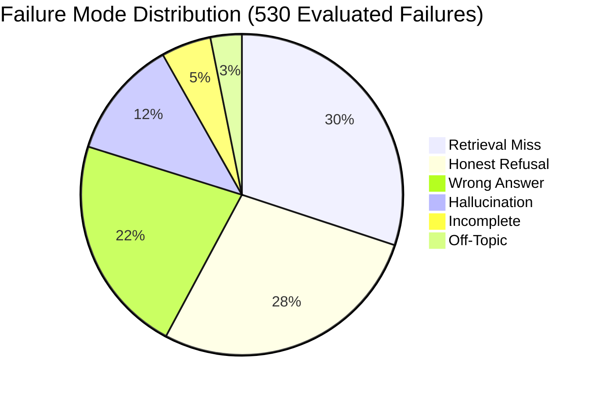

# BhashaCore Research Methodology & Empirical Evaluation

This document outlines the scientific methodology, experimental design, benchmark datasets, evaluation protocols, and empirical findings produced by the **BhashaCore** multilingual evaluation framework.

---

## 1. Background & Motivation

Government and public service chatbots in India (e.g., UMANG, MyScheme, state public health portals) frequently exhibit severe performance degradation when accessed in regional Indian languages. However, citizen feedback that an assistant "performs worse in regional languages" conflates several distinct failure modes:

1. **Parametric Knowledge Deficits:** The base LLM may possess less intrinsic knowledge regarding regional topics.
2. **Reading Comprehension Limitations:** The model may fail to comprehend complex queries written in non-Latin scripts.
3. **Retrieval Misses:** Lexical or semantic search systems may fail to retrieve the correct passage due to morpho-syntactic complexity.
4. **Input Normalization Failures:** Users frequently type Indic languages using Latin characters (informal "Hinglish", "Tanglish", "Telugish"), which standard retrieval systems cannot match against native-script documents.
5. **Cross-Lingual Hallucination:** The model may retrieve passages in one language but hallucinate when instructed to answer in another.

**BhashaCore's Research Contribution:** Rather than reporting aggregate end-to-end scores, BhashaCore establishes a **controlled quality waterfall** that isolates each failure stage independently, holding the generator model constant across all six languages.

---

## 2. Experimental Design: The Four Operational Modes

To isolate where answer quality drops, the evaluation framework executes four distinct modes across all languages:

```mermaid
flowchart TD
    subgraph Mode1 ["Mode 1: Closed-Book"]
        M1Q["User Question"] --> M1Gen["LLM Generator"] --> M1Ans["Answer"]
        M1Note["Measures: Parametric model knowledge & fluency"]
    end

    subgraph Mode2 ["Mode 2: Gold Context"]
        M2Q["User Question"] & M2Gold["Gold Ground-Truth Passage"] --> M2Gen["LLM Generator"] --> M2Ans["Answer"]
        M2Note["Measures: Upper-bound reading comprehension & faithfulness"]
    end

    subgraph Mode3 ["Mode 3: Realistic RAG"]
        M3Q["User Question"] --> M3Ret["BM25 Index (Pool + 3k Distractors)"]
        M3Ret --> M3Top["Top-5 Passages"]
        M3Top & M3Q --> M3Gen["LLM Generator"] --> M3Ans["Answer"]
        M3Note["Measures: Real-world retrieval impact on answer quality"]
    end

    subgraph Mode4 ["Mode 4: RAG + Romanized Query"]
        M4Q["Romanized Question (ITRANS Latin)"] --> M4Ret["BM25 Index (Native-Script Pool)"]
        M4Ret --> M4Top["Top-5 Passages"]
        M4Top & M4Q --> M4Gen["LLM Generator"] --> M4Ans["Answer"]
        M4Note["Measures: Penalty incurred by informal Latin-script typing"]
    end
```

### The Quality Waterfall Formulation

By comparing score deltas across these modes relative to the English Gold-Context ceiling ($4.94 / 5.0$), the quality loss is mathematically decomposed:

$$\Delta_{\text{Total}} = \Delta_{\text{Comprehension}} + \Delta_{\text{Retrieval}} + \Delta_{\text{Input Normalization}}$$

Where:
- **Comprehension Gap:** $\text{Score}_{\text{GoldContext}}(\text{en}) - \text{Score}_{\text{GoldContext}}(\text{lang})$
- **Retrieval Gap:** $\text{Score}_{\text{GoldContext}}(\text{lang}) - \text{Score}_{\text{RAG}}(\text{lang})$
- **Input-Normalization Gap:** $\text{Score}_{\text{RAG}}(\text{lang}) - \text{Score}_{\text{RAG-Translit}}(\text{lang})$

---

## 3. Benchmark Datasets & Retrieval Pools

To evaluate retrieval precision and answer correctness against deterministic ground truth:

| Dataset Component | Source | Configuration / Volume | Role in Benchmark |
|---|---|---|---|
| **Indic QA Questions & Contexts** | AI4Bharat **IndicQA** (`ai4bharat/IndicQA`) | 50 evaluation items / language | Ground-truth questions and gold reference passages for `hi`, `ta`, `te`, `kn`, `ml`. |
| **English QA Questions & Contexts** | **SQuAD v1.1** (Validation Split) | 50 evaluation items | High-resource baseline control questions and gold contexts. |
| **Indic Distractor Passages** | AI4Bharat **IndicCorp v2** | 3,000 streamed passages / language | Hard distractor pool added to each native-script index. |
| **English Distractor Passages** | SQuAD v1.1 Training Split Contexts | 3,000 passages | Distractor pool for the English index. |

### Retrieval Pool Characteristics
Each language retrieval pool (`data/processed/pool_<lang>.jsonl`) contains the gold passage for every evaluation question plus 3,000 distractor passages:
- `pool_en.jsonl`: 2.4 MB (SQuAD contexts + 3,000 distractors)
- `pool_hi.jsonl`: 4.2 MB (IndicQA contexts + 3,000 IndicCorp v2 distractors)
- `pool_ta.jsonl`: 4.0 MB (IndicQA contexts + 3,000 IndicCorp v2 distractors)
- `pool_te.jsonl`: 4.8 MB (IndicQA contexts + 3,000 IndicCorp v2 distractors)
- `pool_kn.jsonl`: 2.9 MB (IndicQA contexts + 3,000 IndicCorp v2 distractors)
- `pool_ml.jsonl`: 4.4 MB (IndicQA contexts + 3,000 IndicCorp v2 distractors)

---

## 4. Evaluation Models & LLM-as-a-Judge Protocol

### 4.1 Generator Configurations
- **Primary Generator:** `minimaxai/minimax-m3.1-flash` (evaluated across all 6 languages and all 4 modes under $n=50$ per condition).
- **Secondary Generator (Robustness Validation):** `z-ai/glm-5.3-flash` (flagship model from a different architecture family, tested under $n=25$ per condition to confirm language effects are model-independent).
- **Production Chat Generator:** Sarvam AI `sarvam-105b-conversations` (live streaming assistant).

### 4.2 The Translate-Then-Judge Framework
Standard LLM judges exhibit linguistic bias when evaluating non-English text directly, often rewarding English-syntax fluency over factual accuracy in Indic scripts.

BhashaCore employs `meta/muse-glimmer-30b` as an automated judge using a **translate-then-judge** evaluation prompt (`src/judge.py`):
1. **Internal Translation:** The judge first translates the user question, retrieved context, gold answer, and generated response into English within its reasoning scratchpad.
2. **Correctness Scoring (0 to 5 Scale):**
   - **5:** Fully correct, answers the question completely with accurate facts.
   - **4:** Mostly correct, minor extraneous detail or phrasing variance.
   - **3:** Partially correct, misses a key component of the answer.
   - **2:** Significant inaccuracies or confusions.
   - **1:** Completely incorrect or hallucinated.
   - **0:** Refusal to answer or ungrounded refusal.
3. **Faithfulness Scoring (1 to 5 Scale):** Evaluates whether the generated response is strictly derived from the provided context passages without ungrounded external assertions.
4. **Issue Classification:** Tags specific failure attributes: `Retrieval miss`, `Refusal`, `Wrong answer`, `Hallucinated`, `Incomplete`, `Off-topic`.

---

## 5. Empirical Results & Findings

### 5.1 Retrieval Performance (Native Script vs. Romanized Input)

BM25 retrieval performance over the 3,000+ passage pools ($n=100$ evaluation queries per language):

| Language | Script | Native Script Recall@5 | Native Script MRR@10 | Romanized Query Recall@5 | Romanized Query MRR@10 |
|---|---|---|---|---|---|
| **English (`en`)** | Latin | **0.950** | **0.914** | — | — |
| **Hindi (`hi`)** | Devanagari | **0.800** | **0.643** | 0.010 | 0.010 |
| **Telugu (`te`)** | Telugu | **0.850** | **0.783** | 0.040 | 0.020 |
| **Malayalam (`ml`)** | Malayalam | **0.840** | **0.688** | 0.090 | 0.078 |
| **Kannada (`kn`)** | Kannada | **0.670** | **0.579** | **0.000** | **0.000** |
| **Tamil (`ta`)** | Tamil | **0.570** | **0.419** | 0.060 | 0.048 |

#### Key Insights on Retrieval:
1. **The Dravidian Agglutination Penalty:** English retrieval achieves near-perfect Recall@5 ($0.95$), while Tamil ($0.57$) and Kannada ($0.67$) experience severe drops. Dravidian languages concatenate nominal stems with multiple case suffixes, preventing exact word-token matches in standard BM25.
2. **The Romanization Cliff:** When users query Indic topics using Latin script ("Hinglish" / "Tanglish"), Recall@5 collapses to $\le 0.09$ across all Indic languages. Un-normalized Romanized queries destroy standard keyword retrieval.

---

### 5.2 Answer Quality Across Modes (0 to 5 Scale)

Evaluated with the primary generator across $n \approx 50$ queries per condition:

| Mode | English (`en`) | Hindi (`hi`) | Telugu (`te`) | Malayalam (`ml`) | Kannada (`kn`) | Tamil (`ta`) |
|---|---|---|---|---|---|---|
| **Closed-Book** | 2.74 | 2.48 | 2.45 | 2.38 | 1.76 | 1.53 |
| **Gold Context** | **4.94** | **4.86** | **4.76** | **4.80** | **4.50** | **4.52** |
| **Realistic RAG** | **4.68** | **4.08** | **4.29** | **3.90** | **3.06** | **2.76** |
| **RAG + Romanized Input**| — | **0.00** | **0.40** | **0.41** | **0.04** | **0.21** |

---

### 5.3 The Quality Waterfall Decomposition

Decomposing the degradation relative to the English Gold-Context benchmark ceiling ($4.94$):

| Quality Waterfall Stage | English | Hindi | Telugu | Malayalam | Kannada | Tamil |
|---|---|---|---|---|---|---|
| **Comprehension Gap** (vs. EN Gold) | — | $-0.08$ | $-0.18$ | $-0.14$ | $-0.44$ | $-0.42$ |
| **Retrieval Gap** (Gold vs. RAG) | $-0.26$ | $-0.78$ | $-0.47$ | $-0.90$ | **$-1.44$** | **$-1.76$** |
| **Input-Normalization Gap** (Native vs. Romanized)| — | **$-4.08$** | **$-3.89$** | **$-3.49$** | **$-3.02$** | **$-2.55$** |

```mermaid
xychart-beta
    title "Answer Correctness Degradation Across Pipeline Stages"
    x-axis ["English", "Hindi", "Telugu", "Malayalam", "Kannada", "Tamil"]
    y-axis "Judge Correctness Score (0 - 5)" 0 --> 5
    bar [4.94, 4.86, 4.76, 4.80, 4.50, 4.52]
    bar [4.68, 4.08, 4.29, 3.90, 3.06, 2.76]
    bar [0.00, 0.00, 0.40, 0.41, 0.04, 0.21]
```

#### Core Empirical Conclusions:
1. **Comprehension is NOT the primary bottleneck:** When supplied with the correct passage, modern LLMs achieve high comprehension and generation accuracy across all Indic languages ($4.50 - 4.86$). The gap between English and Indic comprehension is small ($-0.08$ to $-0.44$).
2. **Retrieval is the primary language penalty in RAG:** The drop between Gold Context and RAG is substantial in Tamil ($-1.76$) and Kannada ($-1.44$), tracking the exact ordering of BM25 retrieval failures.
3. **Romanization is catastrophic and universal:** Romanized input reduces every Indic language to near-zero ($0.00 - 0.41$). Without transliteration normalization, public-sector chatbots fail entirely for citizens typing in Latin script.

---

### 5.4 Failure Taxonomy Analysis

Analysis of 530 evaluated failure cases (Correctness $\le 3$):

- **Dominant Failure Cascade (58% Retrieval Miss $\rightarrow$ 53% Refusal):** Because the generator prompt enforces strict grounding ("Answer only from the provided passages"), retrieval misses trigger honest model refusals rather than fabricated answers.
- **Hallucinations (23%):** Concentrated in Closed-Book mode and in RAG cases where near-miss distractor passages contained entities related to the query.

---

### 5.5 Robustness Validation Across Model Families

To verify that findings reflect fundamental language properties rather than quirks of a single generator, the flagship `z-ai/glm-5.3-flash` was evaluated on an independent subset ($n=25$ / language):

| Mode | English | Hindi | Telugu | Malayalam | Kannada | Tamil |
|---|---|---|---|---|---|---|
| **Gold Context** | 5.00 | 4.64 | 4.80 | 4.68 | 4.64 | 4.44 |
| **RAG** | 4.80 | 3.68 | 4.40 | 3.64 | **3.48** | **2.68** |

**Confirmation:** GLM-5.3 reproduces the identical performance ordering: English achieves near-perfection ($4.80$), Telugu performs best among Indic languages ($4.40$), and Tamil exhibits the steepest degradation ($2.68$).

---

## 6. Recommendations for Public-Sector & Civic Deployments

1. **Mandatory Transliteration Preprocessing:** Implement a dual-retrieval transliteration bridge (e.g., IndicXlit or BhashaCore's dual ITRANS bridge) prior to querying native-script document stores.
2. **Morphology-Aware Stemming for Dravidian Scripts:** Standard whitespace tokenization is insufficient for Tamil, Kannada, Telugu, and Malayalam. Employ subword indexing or 5-character stem augmentation.
3. **Explicit Cross-Lingual Prompt Directives:** Prevent language drift during cross-lingual synthesis by injecting mandatory target-language instructions into system prompts.
